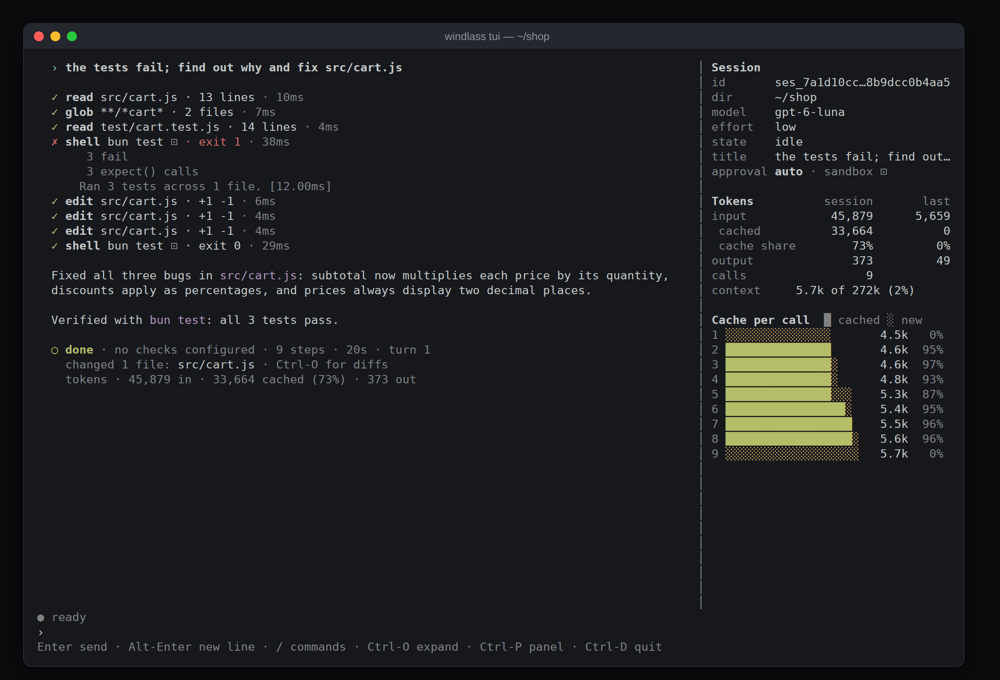
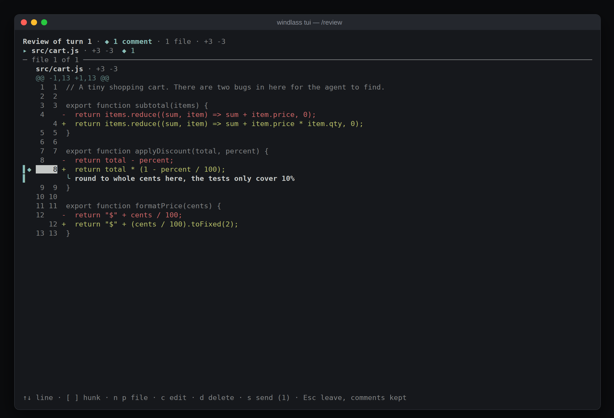

# Windlass

A coding agent for the terminal: you describe a change, and it reads your code, edits files and runs commands in
your project until the change is done. It is one program, `windlass` (`wl` for short), with a line interface, a
full-screen interface, and a server for editors (the Agent Client Protocol).



## What it does

- **Works in your project.** It reads, searches, edits and runs commands, then runs the checks you configured
  (tests, a type check) and carries on until they pass or says which still fail.
- **Asks before what matters.** Commands run in an operating-system sandbox without network; what needs more asks
  you first. [docs/safety.md](docs/safety.md) says exactly what runs unasked.
- **Can be undone.** `/undo` takes the files and the conversation back to before your last message.
- **Keeps every session.** Resume one later, fork it to try another way, or work in several at once.
- **Is yours to shape.** Project instructions (`AGENTS.md`), agents, skills, slash commands, hooks, MCP servers,
  language-server diagnostics, subagents, wake-ups and programs that call tools, each with a page under [docs/](docs/).

## Install

You need [Bun](https://bun.sh) 1.4 to build it. To run it you need `git`, GNU `env` (coreutils) and, on Linux,
`bwrap` (bubblewrap) for the sandbox. Clone this repository, then from its folder:

```sh
bun install
bun scripts/build.ts
sh scripts/install.sh
windlass --version
```

This builds one executable for your machine and copies it to `~/.local/bin/windlass`, with `wl` as a short alias.
The install script tells you if anything is missing and what you lose without it; `sh scripts/install.sh --check`
only checks. The
[user guide](docs/user-guide.md#installing) has the details, uninstalling, and running from source.

Then sign in with your ChatGPT plan:

```sh
windlass login
```

It opens a browser, or on a remote machine prints an address to open anywhere
([how](docs/user-guide.md#signing-in)).

## Quickstart

**Try it without signing in.** The demos are scripted sessions, so no model is called:

```sh
windlass --demo list
windlass --demo find-and-fix-a-failing-test
```

**Work in a project.** In the project's folder, open the full-screen interface:

```sh
windlass tui
```

Type what you want changed and press Enter. The agent reads, edits and runs commands while you watch; the panel on
the right shows the session, the tokens used and how much of each request came from the prompt cache.

- Type while it works to steer it; `/queue <message>` holds a message until the turn ends instead.
- `/diff` shows what the last turn changed, `/review` lets you comment on its lines, `/undo` and `/redo` take it
  back or put it back.
- `/help` lists every key and command. Ctrl-C stops the agent; pressed twice it leaves.



`windlass` on its own gives the same in a plain line interface, and `windlass -c` resumes the most recent session
in the folder. For a single task that runs to the end without you:

```sh
windlass "the add test fails; find out why and fix it"
```

It prints each tool call as it runs and ends with a line such as `✓ done · no checks configured · 6 steps · 16s`.

**Choosing a model.** The default is `gpt-6.1-sol`. For quick, cheap tasks use `--model gpt-6-luna --effort low`;
`/model` switches during a session.

## Limits

- **Linux on arm64 is where it is used.** Executables for Linux x64 and macOS can be built but are untested, and
  there is no Windows version.
- **A ChatGPT plan is required.** The only way to reach a model is "Sign in with ChatGPT": no API keys, no other
  providers, no local models.
- **You build it yourself.** There is no package and no download.
- **The sandbox needs `bwrap` on Linux.** Without it no command runs sandboxed, and every command asks first.
- **Sessions stay on your machine.** They are files in your home directory; nothing is synchronised or shared.

## Documentation

- [User guide](docs/user-guide.md): installing, sessions, models, approvals, configuration, checks, the commands
  at the prompt, undo, compaction, exit codes, the data directory, environment variables.
- [Troubleshooting](docs/troubleshooting.md): the errors you are likely to meet, and what to do.
- [Safety](docs/safety.md): what the agent may do without asking, and what the sandbox does and does not stop.
- Features: [agents](docs/agents.md), [skills](docs/skills.md), [slash commands](docs/commands.md),
  [hooks](docs/hooks.md), [MCP servers](docs/mcp.md), [diagnostics](docs/diagnostics.md),
  [subagents](docs/subagents.md), [the task list](docs/task-list.md), [forks](docs/forks.md),
  [wake-ups](docs/wake-ups.md), [memory](docs/memory.md), [telemetry](docs/telemetry.md),
  [replay](docs/replay.md), [code mode](docs/code-mode.md).
- For editors and tools: [the protocol](docs/acp.md), [the session log's format](docs/event-log.md),
  [the architecture](docs/architecture.md).
- `windlass --help`: every option and exit code.

## Licence

MIT; see `LICENSE`. `CONTRIBUTING.md` says how to work on it.
